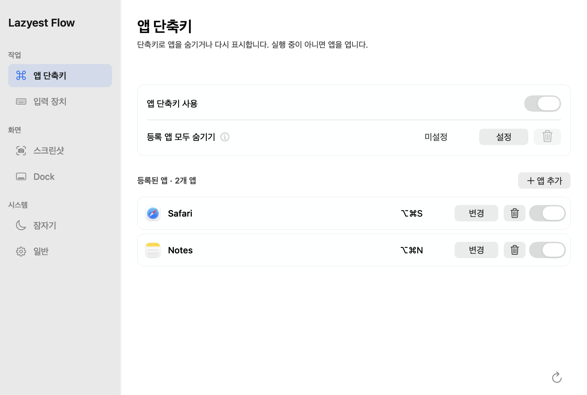
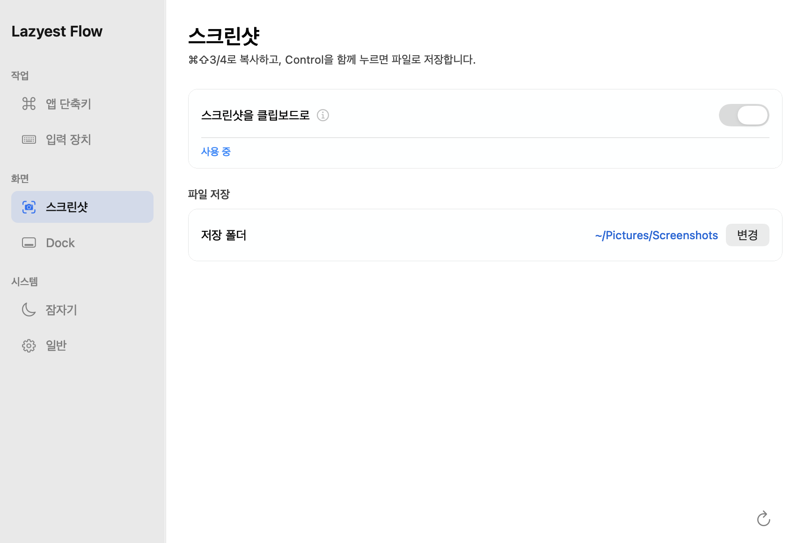
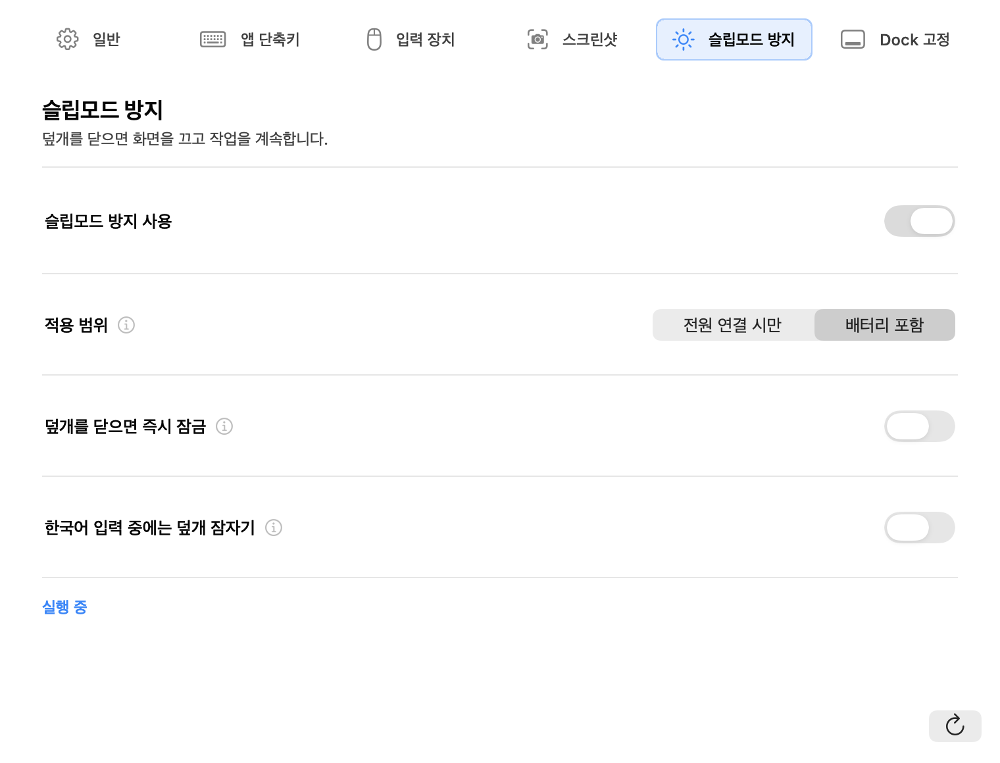
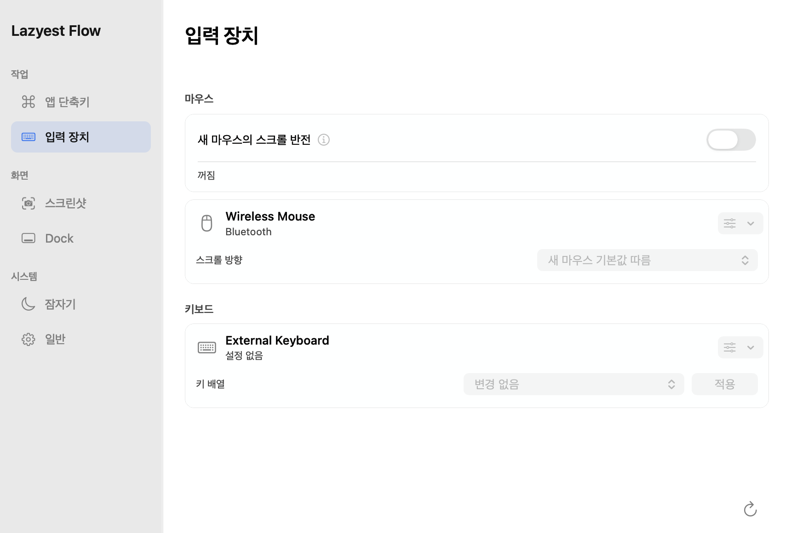

# Lazyest Flow

단축키, 입력 장치, 스크린샷과 잠자기를 한곳에서 관리하는 macOS 메뉴 막대 앱입니다. [Lazyest Setup](https://github.com/lazyest-hyun/lazyest-setup)과 독립적으로 사용할 수 있습니다.



실제 AppKit 설정 화면을 예시 데이터로 렌더링한 이미지입니다.

## 설치와 배포 상태

2026년 9월 7일 기준 **1.2.3 Apple Silicon DMG**의 Developer ID 서명, Apple 공증, 스테이플, Gatekeeper 검사와 설치 확인을 완료했습니다. 동일한 UI 소스에서 한국어·영어, 밝은·어두운 화면, 실제 860/997pt 너비의 UI 48개를 렌더링했고 단축키 편집 취소를 검사했습니다. 공개 GitHub Release에는 게시하지 않았으며, 공개 페이지에 남아 있는 PKG는 이전 버전입니다.

공개되면 DMG와 SHA-256 체크섬을 확인하고 앱을 `/Applications`로 옮겨 실행합니다. 지금 소스에서 설치하려면 다음 안내를 따릅니다.

## 시작하기

macOS 13 이상과 Xcode Command Line Tools의 Swift가 필요합니다. 저장소가 비공개인 동안에는 접근 권한이 있는 GitHub 계정으로 내려받아야 합니다.

```sh
git clone https://github.com/lazyest-hyun/lazyest-flow.git
cd lazyest-flow
./bootstrap.sh install
open "/Applications/Lazyest Flow.app"
```

Swift가 없다면 `xcode-select --install`로 Apple 개발 도구를 설치한 뒤 다시 실행하세요. Homebrew나 전체 Xcode는 필수가 아닙니다.

설치는 현재 소스를 새로 빌드하고 `/Applications/Lazyest Flow.app`에 검증한 앱을 교체합니다. 기존 설정과 로그인 자동 실행은 보존합니다. 새 설치에서는 모든 기능이 꺼져 있으며 앱 단축키도 비어 있습니다. 메뉴 막대에서 설정을 열고 필요한 기능만 켜세요.

설치 결과는 다음 명령으로 확인할 수 있습니다.

```sh
./bootstrap.sh audit
```

## 설정 화면

사이드바에서 작업, 화면, 시스템으로 나누어 필요한 기능을 찾습니다.

| 구분 | 설정 |
| --- | --- |
| 작업 | 앱 단축키, 입력 장치 |
| 화면 | 스크린샷, Dock |
| 시스템 | 잠자기, 일반 |

마지막으로 열었던 페이지와 창의 위치·크기를 기억합니다. 페이지를 바꿔도 제목과 첫 설정 카드의 위치는 유지됩니다. 관련 옵션은 같은 카드에 모으고 자세한 설명은 정보 아이콘의 툴팁에서 확인할 수 있습니다.

## 스크린샷



`스크린샷을 클립보드로`를 켜면 다음처럼 동작합니다.

| 단축키 | 결과 |
| --- | --- |
| ⌘⇧3 | 전체 화면을 클립보드로 복사 |
| ⌘⇧4 | 선택한 영역 또는 창을 클립보드로 복사 |
| ⌃⌘⇧3 또는 ⌃⌘⇧4 | 선택한 폴더에 파일 저장, macOS 미리보기 사용 |
| ⌘⇧5 | macOS 스크린샷 도구 그대로 사용 |

단축키에서 손을 떼면 캡처가 시작됩니다. 영역 선택 취소는 Esc입니다. 파일 저장 위치는 macOS와 공유합니다. 클립보드와 파일을 동시에 저장하는 기능은 제공하지 않으며, 다른 앱의 클립보드 내용을 읽거나 보관하지 않습니다. 접근성 권한이 필요합니다.

## 잠자기



`슬립모드 방지 사용`을 켠 뒤 `전원`에서 적용 범위를, `덮개를 닫을 때`에서 잠금과 한국어 입력 조건을 설정합니다.

- 덮개를 닫으면 화면을 끄고 백그라운드 작업을 유지합니다.
- `전원 연결 시만`과 `배터리 포함` 중 적용 범위를 선택합니다.
- 배터리 20% 이하, 잔량 확인 실패 또는 심한 발열 시 자동으로 중지합니다.
- `덮개를 닫으면 즉시 잠금`으로 화면 꺼짐과 잠금을 별도로 선택합니다.
- `macOS 한국어 입력 시 잠자기`는 macOS 기본 한국어 입력 소스를 사용합니다. 구름 등 외부 입력기의 내부 한/A 상태는 macOS가 공개하지 않아 지원하지 않습니다.
- 직접 Mac을 잠자기 상태로 전환하려면 먼저 이 기능을 끄세요.

처음 켤 때 macOS 관리자 인증으로 전원 보조 도구를 설치합니다. 재빌드한 앱은 새 코드 해시 승인이 필요합니다. 보조 도구는 승인한 사용자와 코드 해시를 확인하고 배터리, 발열, 90초 통신 제한을 별도로 감시합니다. Flow가 종료되면 자신이 적용한 잠자기 방지를 해제합니다. 다른 전원 관리 앱이 같은 시스템 설정을 변경하면 정책이 충돌할 수 있으므로 한 앱에서 관리하는 것을 권장합니다.

## 입력 장치와 단축키



외장 마우스는 장치별 스크롤 방향을 선택합니다. 내장 트랙패드와 Magic Trackpad의 스크롤은 유지합니다. 복합 USB 리시버는 실제 입력을 관찰해 분류하며 필요하면 장치 종류를 직접 선택할 수 있습니다.

마우스와 키보드 카드는 위쪽에 장치명과 상태를, 아래쪽에 스크롤 방향 또는 키 배열을 표시합니다. 장치 종류 메뉴는 각 카드의 오른쪽 위에 있습니다.

키보드의 Windows → Mac 조작키 변환에는 [Karabiner-Elements](https://karabiner-elements.pqrs.org/)가 필요합니다. Flow가 만든 장치별 매핑만 초기화하며 기존 사용자 매핑과 충돌하면 적용을 중단합니다. F18 한/영 전환 규칙은 Setup 또는 Karabiner에서 설정합니다.

앱 단축키는 등록한 앱을 열거나 숨깁니다. 전체 기능을 껐다 켜도 앱별 선택은 유지됩니다. `등록 앱 모두 숨기기`에는 기본 단축키가 없으므로 원하는 키를 직접 지정하세요.

저장한 단축키는 `⌘⌥S`처럼 기호로 표시합니다. 편집 중 Esc를 누르거나 다른 페이지·앱으로 이동하면 입력을 취소하고 기존 단축키를 유지합니다.

## 권한과 업데이트

| 기능 | 필요한 설정 |
| --- | --- |
| 로그인 자동 실행 | 일반 설정에서 선택, macOS 로그인 항목 승인 |
| 스크린샷, 스크롤 반전, 덮개 잠금, Dock 고정 | 시스템 설정의 손쉬운 사용 |
| 덮개 잠자기 방지 | 전원 보조 도구 관리자 인증 |
| 키보드 조작키 변환 | Karabiner-Elements 설치 및 권한 |

1.2.1부터 앱 식별자는 `com.lazyest.flow`입니다. 소스 설치는 이전 설정과 로그인 항목을 이전합니다. 이전 버전에서 앱을 직접 교체하거나 PKG로 업데이트했다면 일반 설정의 `로그인 시 자동 실행`을 한 번 확인하세요. 이후 선택은 저장하여 업데이트 후 복구합니다. 접근성 권한은 새 앱에 다시 허용해야 할 수 있습니다. 이전 식별자는 설치 이전 및 정리에만 사용합니다.

설정은 `~/Library/Application Support/Lazyest Flow/`에 저장됩니다. `일반 > Flow 제거`에서 앱과 보조 도구를 제거하고 설정, Dock 반응, 스크린샷 위치, 키보드 매핑의 초기화 범위를 선택할 수 있습니다.

## 개발 및 검증

```sh
./scripts/check.sh
./bootstrap.sh build
./scripts/package-app.sh "$PWD/dist/Lazyest Flow.app"
.build/release/LazyestFlow --render-previews /tmp/lazyest-flow-previews ko
```

`--render-previews`는 실제 AppKit 설정 UI를 예시 데이터로 그립니다. 앱을 띄우거나 입력, 전원, 클립보드 설정을 변경하지 않습니다. 문서의 이미지는 이 모드로 생성한 예시이며 개인 장치명이나 사용자 경로가 없습니다. 실제 덮개 닫기, 잠금, 화면 캡처와 외장 장치 동작은 사용하는 Mac에서 별도로 확인해야 합니다.

렌더링은 페이지 간 제목, 설명, 본문, 카드와 사이드바 위치를 비교하고 `page-layout.json`에 실제 좌표를 기록합니다. 범위와 결과는 [UI 정렬 검토](docs/ui-layout-review.md)를 참고하세요.

로컬 빌드는 기본적으로 ad-hoc 서명합니다. 별도 인증서를 쓰려면 `LAZYEST_CODESIGN_IDENTITY`를 지정하세요. 명시한 인증서를 사용할 수 없으면 기존 앱을 보존하고 설치를 중단합니다.

```sh
LAZYEST_CODESIGN_IDENTITY="Your Code Signing Identity" ./bootstrap.sh install
```

## 배포 패키지

현재 배포 경로는 아래 `DMG 패키지`입니다. 별도 PKG가 필요한 배포자는 Developer ID Application 및 Installer 인증서와 공증 프로필을 준비해 아래 선택 절차를 사용합니다. 값은 저장소에 기록하지 않습니다.

```sh
LAZYEST_CODESIGN_IDENTITY="Developer ID Application: ..." \
LAZYEST_INSTALLER_IDENTITY="Developer ID Installer: ..." \
LAZYEST_TEAM_ID="..." \
LAZYEST_NOTARY_PROFILE="lazyest-notary" \
./scripts/package-macos-release.sh
```

`--preflight`를 붙이면 준비 상태만 확인합니다. 완료 시 `dist/Lazyest-Flow-<version>-macOS.pkg`와 SHA-256 파일이 생성됩니다. 이 명령은 GitHub에 게시하거나 App Store에 제출하지 않습니다. 소스 빌드 성공과 Apple 서명, 공증, 실제 사용 검증은 각각 확인해야 합니다.

## 로그인 편의 설정

Flow의 **로그인 편의 설정**에서 Mac 시작 시 자동 로그인과 잠자기·화면 보호기 후 암호 요구 설정을 각각 안내합니다. **로그인 시 자동 실행**은 로그인한 뒤 Flow를 실행하는 기존 기능입니다.

- 시작 시 자동 로그인: 시스템 설정 → 사용자 및 그룹 → 다음으로 자동 로그인.
- 잠자기·화면 보호기 후 암호 요구 시간: 시스템 설정 → 잠금 화면.
- Flow는 시스템 설정 앱을 열고 이동 경로를 안내합니다. 공개 API로 보장되지 않는 개별 화면 링크는 사용하지 않습니다. 앱을 열지 못하면 Apple 메뉴에서 직접 여는 경로를 표시합니다.
- FileVault 상태만 `/usr/bin/fdesetup isactive`로 관리자 권한 없이 조회합니다. 설치된 Apple `fdesetup(8)` 매뉴얼의 `true`/종료 코드 0, `false`/종료 코드 1 조합만 확인된 상태로 취급합니다. 실행 실패, 권한 거부, 예상 밖 출력, 3초 시간 초과는 **확인할 수 없음**입니다.
- FileVault가 꺼져 있어도 자동 로그인 가능 여부나 적용 상태를 확정하지 않습니다. 조직의 관리 정책과 Apple 계정 암호 사용 등 나머지 조건은 시스템 설정에서 확인해야 합니다.

암호 없이 접근하도록 설정하면 이 Mac을 사용할 수 있는 다른 사람도 계정의 파일과 앱에 접근할 수 있습니다. 실제 변경과 인증은 사용자가 macOS에서 직접 진행합니다. Flow는 FileVault·계정·암호·잠금 설정을 변경하거나 로그인 암호를 읽고 저장하지 않습니다. FileVault로 암호화된 Mac의 전원을 켤 때는 인증이 필요합니다. 시작 시 자동 로그인은 로그아웃·사용자 전환·수동 잠금에 적용되지 않습니다.

기준: [Apple 자동 로그인 안내](https://support.apple.com/ko-kr/102316). 순수 상태 판단은 `LazyestCore/AutomaticLoginPolicy.swift`, macOS 조회·설정 앱 열기는 `AutomaticLoginSupport.swift`에 분리해 두었습니다.

## 보안 및 라이선스

취약점은 [보안 정책](SECURITY.md)의 비공개 제보 경로를 이용해 주세요. [The Unlicense](UNLICENSE)를 따릅니다.

### DMG 패키지

현재 배포 형식은 DMG입니다. Developer ID Application으로 서명한 앱을 준비하면 Installer 인증서 없이 패키징할 수 있습니다. 이 명령은 앱과 DMG를 각각 Apple에 공증하고 Gatekeeper 검사를 통과한 파일 및 상대 경로 SHA-256 체크섬을 남깁니다. 공개 업로드는 수행하지 않습니다.

```sh
LAZYEST_CODESIGN_IDENTITY="Developer ID Application: <publisher> (<team-id>)" \
LAZYEST_NOTARY_PROFILE="lazyest-notary" \
scripts/package-dmg.sh "$PWD/dist/Lazyest Flow.app" "$PWD/dist/Lazyest-Flow-macOS.dmg"
```

DMG를 열고 앱을 Applications로 옮긴 뒤 `/Applications`의 앱을 실행합니다. 현재 검증한 1.2.3 DMG는 Apple Silicon용입니다. 다른 CPU용 배포를 추가하려면 해당 빌드와 실행을 별도로 검증해야 합니다. 소스 변경 후에는 앱을 다시 빌드하고 서명해야 합니다.
